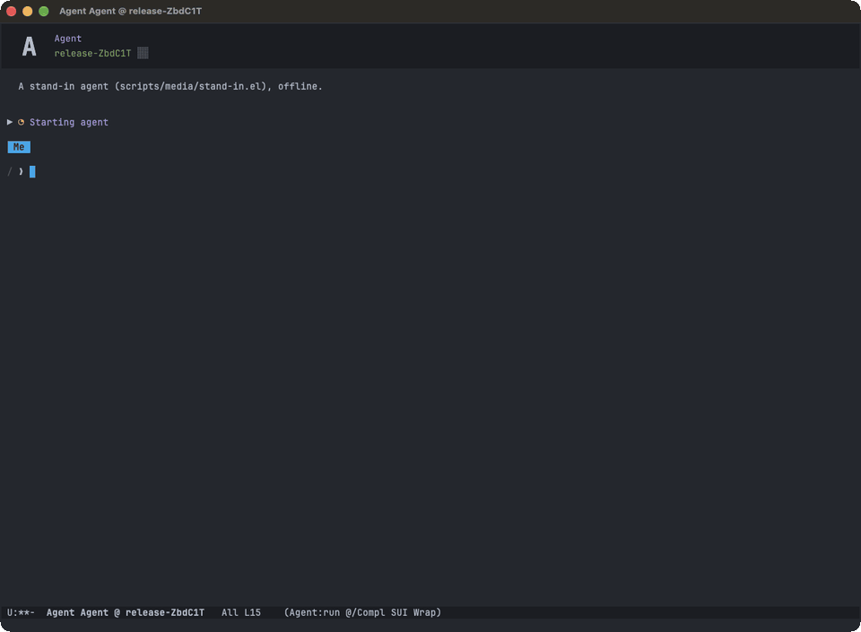
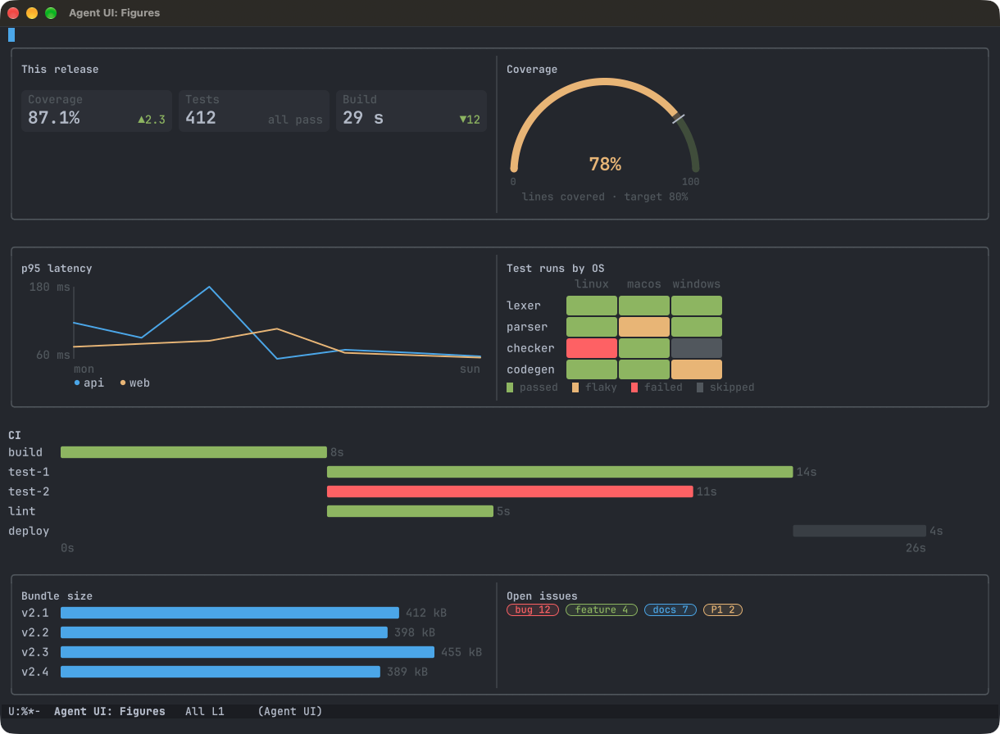
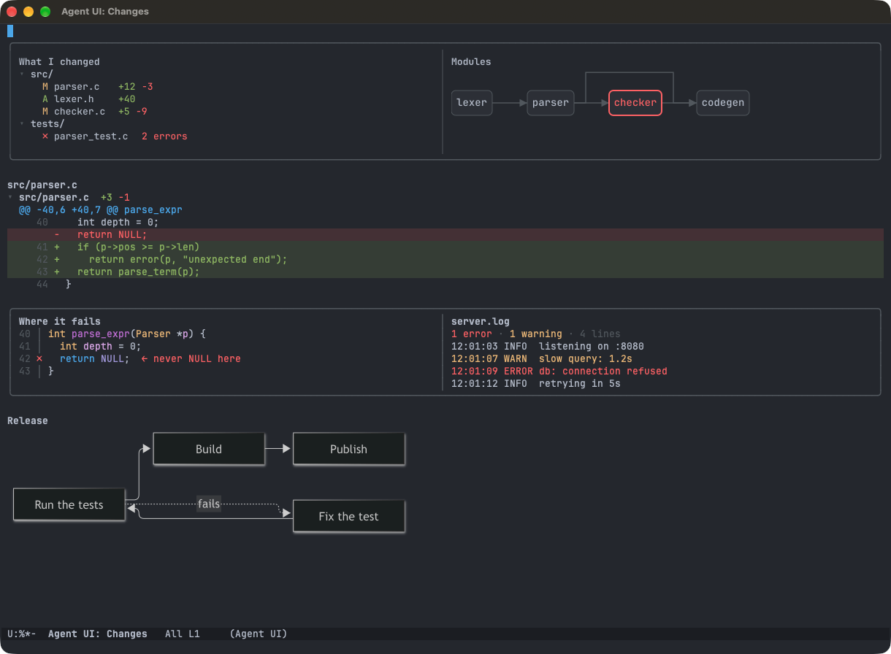
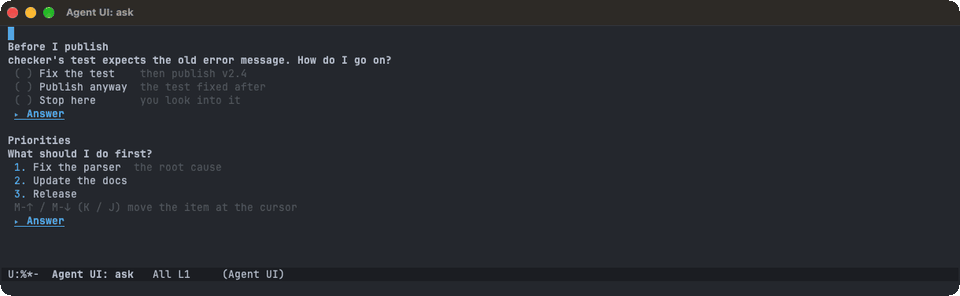
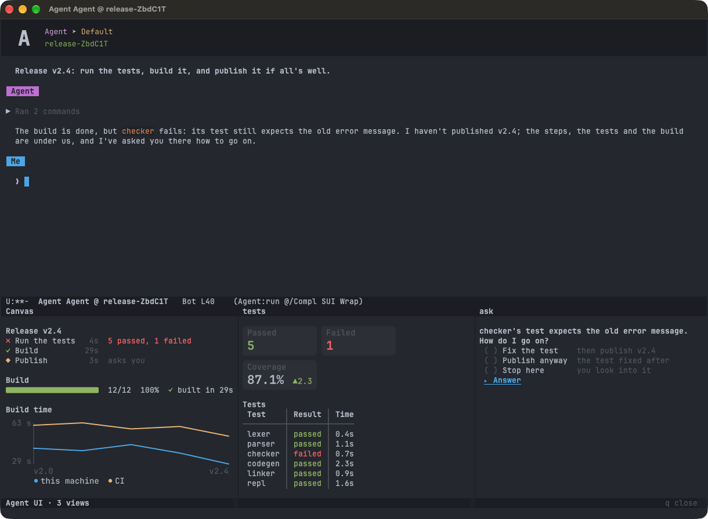
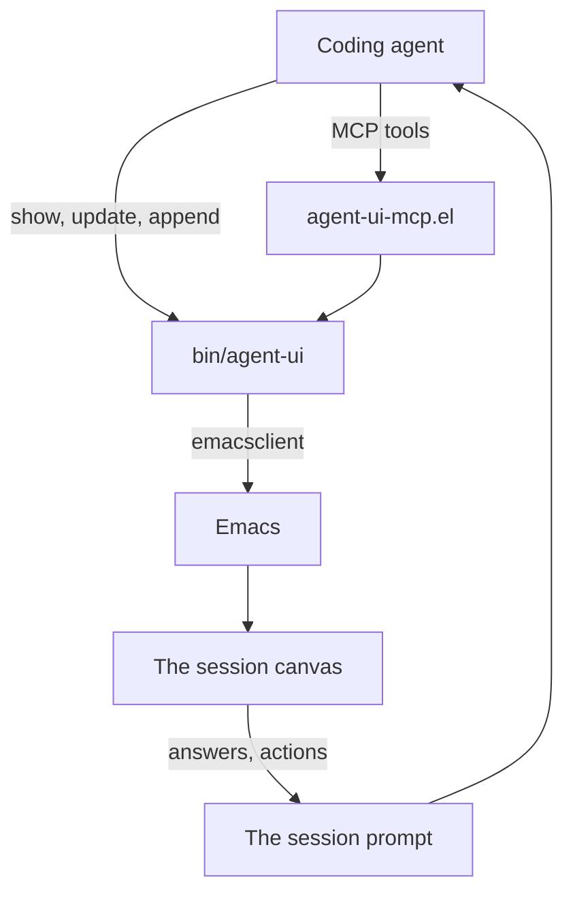

# Agent UI

**A canvas where coding agents show their work, in Emacs.**

Agent UI gives a coding agent running in [agent-shell](https://github.com/xenodium/agent-shell) a canvas at the
bottom of its session's pane: progress bars, checklists, tables, charts, diffs, diagrams, and questions for you. Each
one is updated in place as the work goes on, instead of scrolling away in the conversation.



> [!NOTE]
> Agent UI is young and under active development. Expect rough edges, and please
> [report what you find](https://github.com/smyrgeorge/agent-ui/issues).

## Why

An agent's reply is a stream of text. What it's doing (a plan being worked through, a build running, tests passing
and failing, a question waiting for you) has a shape that a stream of text doesn't hold well. Agent UI gives that
shape a place: the agent shows a component once, then changes it as things change. The conversation keeps the words.

- **30 component types**: `progress`, `steps`, `table`, `chart`, `stats`, `gauge`, `heatmap`, `timeline`, `graph`,
  `mermaid`, `diff`, `code`, `files`, `log`, `activity`, `markdown`, `math`, `image`, `html`, `panel`, and more.
- **Questions with real answers**: `choice`, `confirm`, `form`, `rank`, `slider`, `compare`, a plan to approve, rows
  to pick. The answer goes back into the session's prompt.
- **One canvas per session**, beside its conversation. It closes with the session and comes back when the session is
  resumed.
- **Driven from the agent's shell** with one command (`bin/agent-ui`, JSON in and out), or as **MCP tools**.
- **Sources**: a component can follow a command, a file or a poll by itself, so a progress bar keeps moving while the
  agent waits on a long build.
- **Project panels**: dashboards kept in a repository (`.agent-ui/panels/`), opened on demand.
- **Types of your own**: the agent can define a new component type when none fits. You review it before it's kept.
- Works in a terminal too: everything has a text drawing, and the GUI adds SVG charts, gauges and images.

## Screenshots

| Figures | Changes |
|---|---|
|  |  |

Asking you: a choice answered, then a ranking reordered and sent:



An agent's session with its canvas, its tests canvas and a question waiting:



## Requirements

- Emacs 29.1 or later, running as a server (`M-x server-start`): the command reaches Emacs through `emacsclient`.
- [agent-shell](https://github.com/xenodium/agent-shell) and [vui](https://github.com/d12frosted/vui.el), installed
  as dependencies.
- Optional, for some components:
  - [Mermaid's CLI](https://github.com/mermaid-js/mermaid-cli) (`mmdc`) for `mermaid` diagrams.
  - Node with `mathjax-full`, or LaTeX and `dvisvgm`, for `math`.
  - `curl` for images from URLs.
  - `rsvg-convert` (librsvg) to export a canvas as a PDF.

## Install

Agent UI isn't on MELPA yet. Install it from GitHub.

With `package-vc` (Emacs 29+):

```elisp
(package-vc-install "https://github.com/smyrgeorge/agent-ui")
```

With `use-package` (Emacs 30+):

```elisp
(use-package agent-ui
  :vc (:url "https://github.com/smyrgeorge/agent-ui" :rev :newest)
  :after agent-shell
  :config
  (server-start)
  (agent-ui-mode 1))
```

With [straight.el](https://github.com/radian-software/straight.el):

```elisp
(straight-use-package
 '(agent-ui :host github :repo "smyrgeorge/agent-ui"
            :files (:defaults "bin" "skills" "assets")))
```

With Doom Emacs, in `packages.el`:

```elisp
(package! agent-ui
  :recipe (:host github :repo "smyrgeorge/agent-ui"
           :files (:defaults "bin" "skills" "assets")))
```

The package needs its `bin/`, `skills/` and `assets/` folders, not only its Lisp files: keep them in your recipe's
`:files`.

## Setup

```elisp
(require 'agent-ui)
(server-start)
(agent-ui-mode 1)
```

`agent-ui-mode` ties Agent UI to agent-shell. Each session's agent finds its own canvas, is told about it in its
system prompt (for the agents that take one), and gets Agent UI's MCP tools. Nothing is set up just by loading the
package.

Start an agent-shell session and ask the agent to show you its plan. It reads `skills/agent-ui/SKILL.md` before its
first use, as its system prompt tells it.

## Try it from a shell

Any shell can draw on a canvas while Emacs runs its server. Without an agent-shell session, the canvas opens in a
window of its own:

```sh
AGENT_UI=$(emacsclient --eval 'agent-ui-command' | tr -d '"')

$AGENT_UI show '{"id":"build","type":"progress","title":"Build","max":12,"label":"configuring"}'
$AGENT_UI update build '{"value":7,"label":"linking"}'
$AGENT_UI update build '{"value":12,"status":"done","label":"done in 41s"}'

$AGENT_UI show '{"id":"plan","type":"steps","title":"Release","steps":["Run the tests","Build","Publish"]}'
$AGENT_UI append plan '{"steps":[{"name":"Run the tests","status":"done","detail":"412 passed"}]}'

$AGENT_UI types chart     # a type's properties and an example
$AGENT_UI clear
```

Every reply is JSON: `{"ok":true,"id":"build"}`, or `{"ok":false,"error":"..."}` saying exactly what's wrong.

## How it works



Each agent-shell session starts its agent with `AGENT_UI_SESSION` in its environment, so every request finds that
session's canvas. A component is a JSON object (`type`, `id`, its type's properties), checked against its type before
it's drawn: a wrong one is refused whole, with an error listing the right properties.

## Documentation

- [Getting started](docs/getting-started.md)
- [The command line and MCP](docs/command-line.md)
- [The canvas](docs/canvas.md): its views, keys, actions, questions, sessions
- [Component types](docs/components.md)
- [Sources](docs/sources.md), [project panels](docs/panels.md), [types of your own](docs/custom-types.md)
- [Bugs in Agent UI](docs/bugs.md), [the Emacs Lisp interface](docs/lisp.md)
- [Customization](docs/customization.md)
- [The agents' guide](skills/agent-ui/SKILL.md): what agents read before using it

## Development

```sh
make deps      # clone the dependencies into .deps/
make compile   # byte-compile, warnings as errors
make lint      # package-lint and checkdoc
make test      # the unit tests, in emacs -Q
```

The screenshots and GIFs in this README are made by a script, `scripts/media.sh` (macOS: it uses `screencapture`,
and `ffmpeg` for the GIFs). Each scene in `scripts/media/media.el` plays in a GUI `emacs -Q` of its own, an
agent-shell session with a stand-in agent (`scripts/media/stand-in.el`, offline) for the session's:

```sh
make media-deps   # the dependencies, and doom-themes for the look
make media        # every scene, into docs/images/
scripts/media.sh figures asking   # some of them
```

## License

GPL-3.0-or-later. See [LICENSE](LICENSE).
