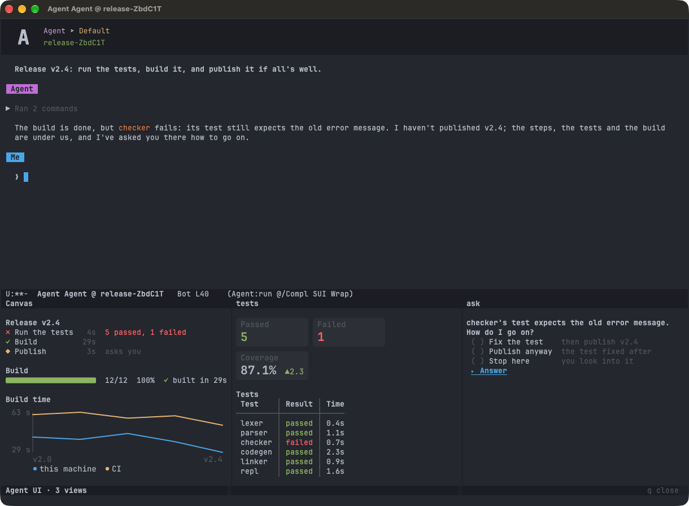

# Agent UI documentation

Agent UI gives a coding agent running in [agent-shell](https://github.com/xenodium/agent-shell) a canvas in Emacs.
The agent shows you progress bars, checklists, tables, charts, diffs, diagrams and questions there, at the bottom of
its session's pane, and updates each of them in place as the work goes on.

## Contents

- [Getting started](getting-started.md): installing it, turning it on, checking the setup (`agent-ui-doctor`), a first
  component from a shell, what the agent is told, and its MCP tools.
- [The command line](command-line.md): every `bin/agent-ui` operation, its JSON in and out, exit statuses, options,
  environment variables, and the same operations as MCP tools.
- [The canvas](canvas.md): the canvas buffer, its views in the session's pane, its keys, finished components closing,
  buttons, questions waiting for you, canvases kept with their sessions, and components in the conversation.
- [Components](components.md): all 30 component types, the ones that show and the ones that ask, with JSON examples.
- [Sources](sources.md): components that follow a command, a file or a polled command, updated by Emacs itself.
- [Project panels](panels.md): dashboards kept in a project's repository and opened again later.
- [Custom types](custom-types.md): defining a component type with `agent-ui-define`, and the types the agent makes,
  staged for your review.
- [Bugs in Agent UI](bugs.md): reporting a problem with Agent UI itself, by you or by the agent.
- [Emacs Lisp interface](lisp.md): the operations from Lisp, sections, and hooks.
- [Customization](customization.md): every user option, grouped, with its default.
