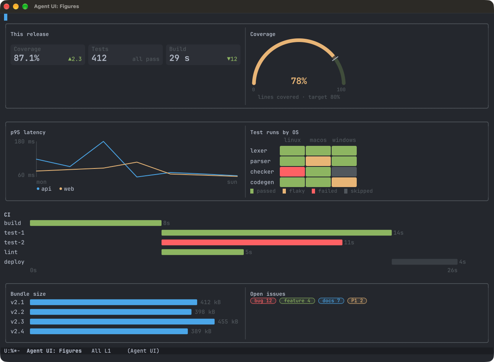
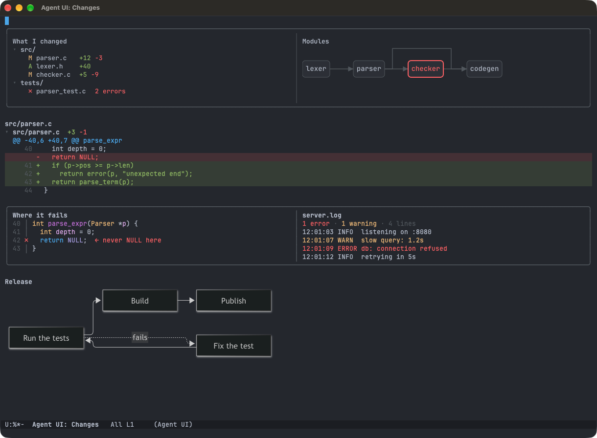
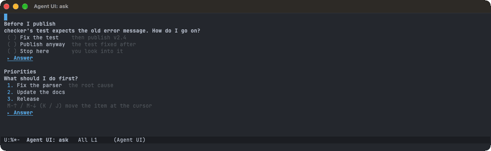

# Components

Agent UI has 30 component types. `agent-ui types` lists them, and `agent-ui types TYPE` gives one type's every property
with an example. Every component also takes the properties common to all types (`id`, `type`, `title`, `caption`,
`source`, `actions`, `close`, `with`), described in [The command line](command-line.md#a-component).

A property of kind `file` is relative to the agent's directory. It's a local file (a remote one, `/ssh:...`, is
refused), read as it is on disk: no file handler of Emacs's runs on it (a `.gpg` file isn't decrypted). Where a
component shows something that can be opened (a file, an image, a page), `RET` or a click on it opens it.

## All types

| Type | What it's for |
|---|---|
| [`activity`](#activity) | What one thing is doing now (a script, an agent at work): a header and its last lines of output. |
| [`chart`](#chart) | Numbers: lines, bars, a histogram or a sparkline. |
| [`choice`](#choice) | A question with options to pick, one or several, and a note. |
| [`code`](#code) | A code snippet, highlighted, its lines numbered and linked to its file, with notes on marked lines. |
| [`compare`](#compare) | Alternatives side by side, for you to pick the better one. |
| [`confirm`](#confirm) | A yes or no gate before something risky. |
| [`countdown`](#countdown) | Time elapsed since a start, or left until an end, ticking. |
| [`diff`](#diff) | Changes from a unified diff, by file and hunk. |
| [`files`](#files) | Files with their state and counts, flat or as a tree. |
| [`form`](#form) | Several fields you fill in together. |
| [`gauge`](#gauge) | One value against its range, thresholds and target. |
| [`graph`](#graph) | Nodes and edges, laid out by Agent UI itself. |
| [`heatmap`](#heatmap) | A grid of cells coloured by value or state. |
| [`html`](#html) | A web page as a card: its title and the start of its text. |
| [`image`](#image) | An image file, or one from a URL. |
| [`log`](#log) | Lines of output coloured by level, errors and warnings counted. |
| [`markdown`](#markdown) | Markdown, drawn as agent-shell draws replies. |
| [`math`](#math) | Formulas typeset from LaTeX math. |
| [`mermaid`](#mermaid) | A Mermaid diagram. |
| [`panel`](#panel) | Components laid out together in a row or a column, in a border. |
| [`progress`](#progress) | A progress bar, with its rate and time left. |
| [`rank`](#rank) | Items you put in order. |
| [`slider`](#slider) | A number you tune in a range. |
| [`stats`](#stats) | A row of figures with their change. |
| [`steps`](#steps) | A checklist whose steps change state; with `approve`, a plan you approve first. |
| [`table`](#table) | Columns and rows that fit the width; with `select`, rows you pick. |
| [`tags`](#tags) | A row of chips with counts; with `select`, chips you pick. |
| [`text`](#text) | A paragraph of plain text. |
| [`timeline`](#timeline) | Tasks as bars on a time axis. |
| [`todo`](#todo) | A checklist you and the agent both tick. |





## Components that show

### text

A paragraph, its lines wrapped to the width. `face` says what it is: `plain` (the default), `muted`, `success`,
`warning` or `error`. For headings, lists or code, use `markdown`.

```json
{"id": "status", "type": "text", "text": "All 412 tests pass.", "face": "success"}
```

### markdown

Markdown, drawn as agent-shell draws the agent's replies: headings, emphasis, inline code, lists, task lists, tables,
fenced code highlighted by its language, and links. Its ```` ```mermaid ```` blocks are drawn as diagrams, as the
`mermaid` type draws them. Images in it show as their text. Property: `markdown`.

```json
{"id": "plan", "type": "markdown", "title": "Plan",
 "markdown": "1. **Parse** the config\n2. Check it against `schema.json`\n3. Write the report"}
```

### table

Columns and rows that fit the width; a long cell wraps in its column (or, with `nowrap`, is cut with `…`). Cells
reading `passed`, `failed`, `running`, `pending` and the like are coloured.

- `key` (a column's index from 0, or its name): appending a row whose key is already there replaces that row.
- `sort` and `descending`: the column its rows are sorted by. `s` on a column in the canvas sorts by it.
- `align`: each column's alignment, `left`, `right` or `center` (numbers align right).
- `row-actions`: buttons on each row, `[{"label", "prompt", "submit"}]`, whose prompt can name a cell as `{Column}`,
  or the whole row as `{row}`.
- `row-open`: makes the row itself a button, `{"prompt", "submit", "help"}`.
- `select`: you pick rows ([below](#select-on-a-table-files-or-tags)).

```json
{"id": "tests", "type": "table", "title": "Tests", "columns": ["Test", "Result", "Time"], "key": 0,
 "rows": [["lexer", "passed", "0.4s"], ["parser", "running", null]]}
```

### progress

A bar, or, without `max`, a block going to and fro while there's no known end. Its `label` follows the bar (under it,
wrapped, when too long), and `unit` says what `value` counts. `status` `done` or `failed` colours it and stops it.

On a canvas, the bar works out its rate and time left from its updates over time. For work items minutes apart (bugs
fixed one by one), a line under it shows the time elapsed (since its first value, or `started`), how long an item
takes, the time left (a range when items vary a lot) and when it should end. An item's time is the median of the
latest 8, leaving out pauses over 45 minutes (`agent-ui-progress-pause`). Once stopped, it shows the time it took. Its
times are kept with it. With `pie`, it's drawn small on one line (`◑ 7/12  58%  linking`), with a pie in a graphical
frame.

```sh
agent-ui show '{"id":"bugs","type":"progress","title":"Bug fixing","max":58,"unit":"bugs"}'
agent-ui update bugs '{"value":12,"label":"the parser'\''s error recovery"}'
```

```text
Bug fixing
████████▎░░░░░░░░░░░░░░░░░░░░░░░░░░░░░░░  12/58 bugs  20%  the parser's error recovery
1h 48m elapsed · ~9 min a bug (last 8) · ~6h 50m left, about 01:40
```

### steps

A checklist whose steps change state, a line each. A step is a name (pending), or an object with `name`, `status`
(`pending`, `running`, `waiting`, `done`, `failed`, `skipped`), `detail` (a note after it), `seconds` (how long it
took; otherwise timed from running to done), `steps` (its own steps, drawn under it) and `body` (Markdown it unfolds
to, with `RET`). A step waiting for you shows `◆` in the warning colour, timed as running. Appending a step whose name
is already there changes it in place; with `"parent": "Build"`, among that step's own steps. With `approve`, it's a
plan you approve first ([below](#steps-with-approve)).

```json
{"id": "release", "type": "steps", "title": "Release",
 "steps": [{"name": "Run the tests", "status": "done", "detail": "412 passed", "seconds": 41},
           {"name": "Build the release", "status": "running",
            "steps": [{"name": "compile", "status": "done", "seconds": 8}, {"name": "link", "status": "running"}]},
           "Publish"]}
```

```text
Release
✓ Run the tests      41s  412 passed
● Build the release
  ✓ compile           8s
  ● link
○ Publish
```

### chart

`kind` is `line` (the default; several `series`, each in its colour; with `times`, on a time axis), `bar` (a bar per
value, `labels` naming them; several series grouped under each label, or `stacked`), `histogram` (its values counted
in `bins`) or `sparkline`. Drawn as SVG in a graphical frame and as characters in a terminal. Appending values makes
it live, and `window` keeps only the latest so many. Other properties: `unit`, `min`, `max`, `height`.

```json
{"id": "latency", "type": "chart", "title": "p95 latency (ms)", "kind": "bar",
 "labels": ["mon", "tue", "wed", "thu"], "values": [120, 95, 180, 60]}
```

```text
p95 latency (ms)
mon  ██████████████████████████▋               120
tue  █████████████████████                      95
wed  ████████████████████████████████████████  180
thu  █████████████▎                             60
```

### stats

A row of figures, each with its change: the summary at the top of a canvas. A figure is `{"label", "value", "unit",
"change", "good", "face"}`. `change` is a number (shown with `▲` or `▼`) or text; `good` is `up` (the default: a rise
is good, in green), `down` (a rise is bad, in red) or `none`. Tiles in a graphical frame, side by side as text.

```json
{"id": "summary", "type": "stats",
 "figures": [{"label": "Coverage", "value": 87.1, "unit": "%", "change": 2.3},
             {"label": "Tests", "value": 412, "change": "all pass"},
             {"label": "Build", "value": 29, "unit": "s", "change": -12, "good": "down"}]}
```

### gauge

One value against its range and thresholds: coverage against a target, a budget used, a latency against an SLO.
`thresholds` are zones, each `{"at", "face"}` colouring from `at` up to the next; the value is in its zone's colour,
and `target` is a mark. A bar in text, a half-circle arc in a graphical frame. Several fit side by side in a panel's
row. Other properties: `min` (0), `max` (100), `unit`, `label`.

```json
{"id": "coverage", "type": "gauge", "title": "Coverage", "value": 78, "unit": "%", "target": 80,
 "label": "lines covered",
 "thresholds": [{"at": 0, "face": "error"}, {"at": 70, "face": "warning"}, {"at": 80, "face": "success"}]}
```

### countdown

Time ticking while you wait: elapsed `since` a start, or left `until` an end. Each is a timestamp, epoch seconds, or
seconds from now (or ago). Its last `warn` seconds are in the warning colour, and past the end it says "ended 2m ago".
In a graphical frame, a tile with the time in large type. It's redrawn only while its canvas is in a window.

```json
{"id": "limit", "type": "countdown", "title": "Rate limit", "label": "Resets in", "until": 252, "warn": 60}
```

### tags

A row of chips: a project's labels, a run's statuses, the filters in use. A chip is a label, or `{"label", "face",
"color", "count", "prompt"}`. `[bug 12]` in a terminal, a rounded tag in a graphical frame. Chips wrap, and a chip is
never split. A chip with a `prompt` is a button that puts it into the session's prompt. Appending a tag with the same
label changes it. With `select`, you pick chips.

```json
{"id": "labels", "type": "tags", "title": "Labels",
 "tags": [{"label": "bug", "face": "error", "count": 12}, {"label": "feature", "face": "success", "count": 4},
          {"label": "docs", "face": "muted"}]}
```

### files

Files with their state (`changed`, `added`, `deleted`, `renamed`, `failing`, `passing`) and counts, flat or, with
`tree`, grouped by folder. A file is a path, or `{"path", "status", "added", "removed", "errors", "line", "note"}`.
`RET` folds a folder, or opens a file at its line. `dir` is where they are (the agent's directory by default). With
`select`, you pick files.

```json
{"id": "changed", "type": "files", "title": "What I changed", "tree": true,
 "files": [{"path": "src/parser.c", "status": "changed", "added": 12, "removed": 3},
           {"path": "src/lexer.h", "status": "added", "added": 40},
           {"path": "tests/parser_test.c", "status": "failing", "errors": 2, "line": 88}]}
```

### log

Lines of output coloured by level, found from their words (error, fatal, panic, failed; warn; info; debug, trace) or
given. Errors and warnings are counted above them, the last `show` lines are shown (15) and `keep` are kept (1000),
long ones wrapped. `lines` is text, a line each, or a list. A line can be in columns: its `time` (muted, shown when it
changes), a `mark` (in its `mark-face`), its `source` (a job, a service, each in its colour, in the order of
`sources`), its `text` (pieces, each text or `{"text", "face"}`), `indent`, and `right` (at its end, how long it
took). `{"gap": "17m"}` is a pause. `unit` names what's counted (`event`: 12 events), and `right` at the counts line's
end gives the log's span. A [source](sources.md) with `"into": "lines"` follows a file as it grows.

```json
{"id": "server", "type": "log", "title": "server.log",
 "lines": "12:01:03 INFO  listening on :8080\n12:01:07 WARN  slow query: 1.2s\n12:01:09 ERROR db: connection refused"}
```

### activity

What one thing is doing now, such as a script or an agent at work. A header line has its `mark` (`●` running, `◆`
asks you) in its `mark-face`, its `owner` (in its colour, by its place in `sources`, as a log's), its `label`, its
`detail` (muted) and `right` at its end (in `right-face`). Under it, its last `show` lines (5) on a rail, each cut to
the width (a log's lines), `empty` while there are none, and a `footer` closing them.

```json
{"id": "capture", "type": "activity", "label": "screenshots.sh", "owner": "capture", "detail": "step 1 of 2",
 "right": "1m 23s", "lines": ["wrote screens/pane.png", "error: window not found"],
 "footer": "the last 2 of 214 lines"}
```

### timeline

Tasks as bars on a time axis: `{"name", "start", "end" or "duration", "status"}`, with times in seconds or timestamps.
A task without an end or a duration runs until now, growing. `status` (`running`, `done`, `failed`, `queued`) colours
it, and a scale is drawn under them. Times under 1.5 seconds are shown in milliseconds
(`agent-ui-milliseconds-below`). SVG in a graphical frame.

```json
{"id": "ci", "type": "timeline", "title": "CI",
 "tasks": [{"name": "build", "start": 0, "duration": 8},
           {"name": "test-1", "start": 8, "duration": 14},
           {"name": "test-2", "start": 8, "duration": 11, "status": "failed"},
           {"name": "deploy", "start": 22, "duration": 4, "status": "queued"}]}
```

### graph

Nodes and edges, laid out in layers by Agent UI itself (no Graphviz needed). Nodes are names or `{"id", "label",
"status"}`, with `status` `ok`, `error`, `warning` or `active` colouring a node; edges are `[from, to]` or `{"from",
"to", "label"}`. In a graphical frame, boxes and curved arrows, left to right or, with `"direction": "down"`,
downwards, shrunk to fit; in a pane too narrow, laid out downwards, or as text. As text, each node lists its arrows.
At most `agent-ui-max-rows` nodes (500) and ten times as many edges.

```json
{"id": "modules", "type": "graph", "title": "Modules",
 "nodes": ["lexer", "parser", {"id": "checker", "status": "error"}, "codegen"],
 "edges": [["lexer", "parser"], ["parser", "checker"], ["parser", "codegen"], ["checker", "codegen"]]}
```

### mermaid

A Mermaid diagram (flowchart, sequence, state, class, ER, Gantt, mind map...). In a graphical frame, it's drawn as an
image in the background by `agent-ui-mermaid-render-function`. The default, `agent-ui-mermaid-render`, runs Mermaid's
command line tool (`agent-ui-mmdc`, `mmdc` by default), caches the result in `agent-ui-mermaid-cache-directory`, and
draws it dark or light to match the frame, at most the pane's width. An update with a new diagram draws it anew. Until
the image is there, in a terminal, or without `mmdc`, the diagram's source is shown (coloured by mermaid-mode if it's
installed); on an error, Mermaid's message under it.

After switching themes, `agent-ui-mermaid-theme-changed` draws every diagram again in the new colours:

```elisp
(add-hook 'enable-theme-functions (lambda (_theme) (agent-ui-mermaid-theme-changed)))
```

```json
{"id": "release-flow", "type": "mermaid", "title": "Release", "diagram": "flowchart LR\n    build --> test --> deploy"}
```

### math

Formulas typeset from LaTeX math: `tex` (without `$` or `\[`), and `display`, `block` (the default: on its own,
larger) or `inline`. In a graphical frame, an image typeset in the background, sized to the font and in the theme's
text colour, when a tool is installed: MathJax through node (`npm install -g mathjax-full`; Agent UI runs its own
`assets/tex2svg.js`), or LaTeX and `dvisvgm`. `agent-ui-math-tool` picks one: `auto` (the default: MathJax if found
in node's global modules, else LaTeX), `mathjax`, `latex` or `none`. Results are cached in
`agent-ui-math-cache-directory`. In a terminal, or without a tool, it's drawn in Unicode where it's simple
(`∑ᵢ₌₁ⁿ i = (n(n+1))/2`), else as its source.

```json
{"id": "gauss", "type": "math", "title": "Gauss", "tex": "\\sum_{i=1}^{n} i = \\frac{n(n+1)}{2}"}
```

### image

An image file (PNG, JPEG, GIF, WebP, SVG, an Excalidraw drawing's `.excalidraw.svg`), or one from a `url`. In a
graphical frame, it's at most `width` percent of the pane wide (100) and `height` lines high (20), never larger than
itself. An image from a URL is downloaded once with `curl` and kept in `agent-ui-image-cache-directory`. In a terminal,
a line names it, with its `alt`. `RET` opens it with `agent-ui-open-file-function`.

```json
{"id": "login", "type": "image", "title": "The login page", "file": "screenshots/login.png",
 "alt": "After the fix", "width": 60}
```

### html

A web page as a card: its title and the first `lines` of its text (4), read from an HTML `file` (scripts, styles and
tags left out); a `url`'s card shows its address. `RET` opens it with `agent-ui-open-page-function`, in the browser by
default.

```json
{"id": "coverage-report", "type": "html", "file": "coverage/index.html", "lines": 3}
```

### code

A snippet highlighted by its `language`'s major mode (a mode's name without `-mode`; otherwise the file's), its lines
numbered from `from` and linked to `file` (`RET` opens it there). Long lines wrap. Without `code`, it shows `file`'s
lines `from` to `to`, read when drawn. `marks` are `{"line", "kind", "note"}`, with `kind` `error`, `warning`,
`change` or `info`: a sign in the gutter and the note after the line. You can comment on its lines with `c`
([Review comments](canvas.md#review-comments)).

```json
{"id": "where", "type": "code", "title": "Where it fails", "language": "c", "from": 40,
 "code": "int parse_expr(Parser *p) {\n  return NULL;\n}",
 "marks": [{"line": 41, "kind": "error", "note": "never NULL here"}]}
```

### heatmap

A grid of cells: `rows` and `columns` (their labels), and `values`, a row of cells for each row. A number is coloured
on a `scale`, `blue` (the default), `green-red` (low good, high bad) or `red-green`; a word by its state (`passed`,
`failed`, `flaky`, `skipped`...); `null` is empty. A legend goes under it, and in a graphical frame the cells are SVG
with their values. Columns whose labels don't fit are numbered, with a key under the grid.

```json
{"id": "runs", "type": "heatmap", "title": "Test runs by OS",
 "rows": ["lexer", "parser", "checker"], "columns": ["linux", "macos", "windows"],
 "values": [["passed", "passed", "passed"], ["passed", "flaky", "passed"], ["failed", "passed", "skipped"]]}
```

### diff

Changes from a unified diff (`git diff`'s), by file, with its lines added and removed counted, and by hunk: coloured,
with line numbers, long lines wrapped. `RET` on a line opens its file there, relative to `dir` (the agent's directory).
A [source](sources.md) such as `{"poll": "git diff", "every": 5, "into": "diff"}` follows the work tree. You can
comment on its lines with `c`. With `accept`, the changes are proposed for you to accept or reject
([below](#diff-with-accept)).

```json
{"id": "changes", "type": "diff", "title": "My changes",
 "diff": "diff --git a/src/parser.c b/src/parser.c\n--- a/src/parser.c\n+++ b/src/parser.c\n@@ -40,3 +40,3 @@ parse_expr\n   int depth = 0;\n-  return NULL;\n+  return parse_term(p);\n }\n"}
```

### panel

Components laid out together: `children` (ordinary components), as a `row` (side by side, sharing the width by
`weights`, equal by default) or a `column` (the default), in a `border` (on by default). Panels nest: rows of
columns, columns of rows. A row too narrow (a child under `min-width`, 24) stacks its children.

- In a graphical frame, a row with a chart, graph or image is drawn as one image, its children side by side; their
  buttons can't be clicked there. Chips and pies, a line high, stay in its text.
- Each child is a component of its own: updated, appended to, removed, shown again, snapshot and linked by its id. Its
  id is unique on the canvas; a child without one gets its place's (`PANEL.1`, and so on).
- A child's source runs with it.

```json
{"id": "release", "type": "panel", "title": "Release", "layout": "row",
 "children": [{"id": "build", "type": "progress", "title": "Build", "value": 8, "max": 12},
              {"id": "tests", "type": "table", "title": "Tests", "columns": ["Test", "Result"],
               "rows": [["lexer", "passed"], ["parser", "failed"]]}]}
```

## Components that ask

The agent asks with these, on a canvas of its own ([A question waiting](canvas.md#a-question-waiting)). Your answer is
sent to the agent at once, as `Answer to TYPE ID (QUESTION): …`, and most then show the answer, locked. Their state
(what you picked, your note, the answer) is the component's own, so it survives a redraw and comes back with a resumed
session.



### Keys for questions

| Key | What it does |
|---|---|
| `RET` or a click | Pick an option, a row, a chip or a file, or press a button (Answer, Send, All / None, a note). |
| `M-<up>` / `M-<down>` (or `K` / `J`) | Move the rank's item at point. |
| `x` | Drop a plan's step (struck through), or reject a diff's hunk. Again: take it back. |
| `e` | Reword a plan's step. |
| `h` / `l` (or `<left>` / `<right>`) | On a slider's track: move the knob a step. |
| `H` / `L` (or `S-<left>` / `S-<right>`) | On a slider's track: move the knob ten steps. |
| A click on a slider's track | Put the knob there. |
| `RET` on a form's Fill in | Fill it in, in a buffer of its own. |
| `TAB` (in a form's buffer) | Go to the next field. |
| `C-c C-c` (in a form's buffer) | Send it. |
| `C-c C-k` (in a form's buffer) | Cancel, keeping what you typed. |

### choice

A question with `options` to pick (labels, or `{"label", "detail"}`), one or, with `multiple`, several, and a note
with `note`. Answer sends `Answer to choice ID (QUESTION): A, B. Note: …`, then it shows the answer. `selected` gives
a default.

```json
{"id": "fix", "type": "choice", "title": "Before I go on",
 "question": "The checker test expects the old error message. Which fix?",
 "options": [{"label": "Change the test", "detail": "keeps the new message"},
             {"label": "Revert the message", "detail": "as it was before"}],
 "note": true}
```

```text
Before I go on
The checker test expects the old error message. Which fix?
 ( ) Change the test     keeps the new message
 ( ) Revert the message  as it was before
 ✎ Add a note
 ⏵ Answer
```

### compare

Alternatives side by side for you to pick the better one, when they need showing rather than naming: code versions,
texts, approaches, diffs. `options` are 2 to 4 `{"label", "component"}`, each component drawn in its column under its
label, stacked when the pane is narrow. Several can be picked with `multiple`, and a note is on by default. Answer
sends `Answer to compare ID (QUESTION): B. Note: …`.

```json
{"id": "style", "type": "compare", "title": "Two ways", "question": "Which version reads better?",
 "options": [{"label": "A: a loop", "component": {"type": "code", "language": "python",
                                                "code": "total = 0\nfor x in xs:\n    total += x"}},
             {"label": "B: sum", "component": {"type": "code", "language": "python", "code": "total = sum(xs)"}}]}
```

### confirm

A yes or no gate before something risky (deploying, deleting, pushing): its `question`, and what will happen as
`details` (lines) or a `diff`. With `"danger": "high"`, it's in red, and Proceed asks you to type a `word` first (the
branch's name, say; `yes` if none is given) and refuses another. Proceed or Cancel (their labels are `proceed` and
`cancel`) sends `Answer to confirm ID (QUESTION): proceed` (or `cancel`), then it shows the answer.

```json
{"id": "push", "type": "confirm", "title": "Before I push", "question": "Force-push to origin/main?",
 "details": ["Rewrites the last 3 commits", "Others' work on main may be lost"],
 "danger": "high", "word": "main"}
```

### form

Several fields you answer together, such as a new ticket's details. Each field is `{"name", "label", "type",
"required", "min", "max", "options", "placeholder", "value"}`, with `type` one of `text` (the default), `integer`,
`number`, `boolean`, `select` (one of its `options`), `file` or `directory`. On the canvas, it shows its fields and
values and a **Fill in** button. Its buffer opens in a new window, with [vui](https://github.com/d12frosted/vui.el)'s
fields, checked as you type. Sending it sends `Answer to form ID (QUESTION): {JSON of the values}`, then it shows the
values.

```json
{"id": "ticket", "type": "form", "title": "New ticket", "question": "What should the ticket say?",
 "fields": [{"name": "title", "label": "Title", "required": true, "value": "Fix the parser"},
            {"name": "priority", "label": "Priority", "type": "integer", "min": 0, "max": 4, "value": 2},
            {"name": "type", "label": "Type", "type": "select", "options": ["bug", "task", "feature"], "value": "bug"},
            {"name": "blocking", "label": "Blocking", "type": "boolean"}]}
```

### rank

`items` you put in order (priorities, the order to do things in), labels or `{"label", "detail"}`, numbered, with a
note if `note`. Answer sends `Answer to rank ID (QUESTION): in this order: C, A, B`, then it shows the order.

```json
{"id": "first", "type": "rank", "title": "Priorities", "question": "What should I do first?",
 "items": [{"label": "Fix the parser", "detail": "the root cause"}, "Update the docs", "Release"]}
```

### slider

A number you tune in a range (a threshold, a timeout): `label`, `min`, `max`, `step` (1), `unit`, and `value` where it
starts, drawn as a track with the knob at its value. Set sends `Answer to slider ID (LABEL): 42 ms`. With `live`, each
value is sent once the knob rests, as `Slider ID (LABEL) set to 42 ms`, and there's no Set button. It's sent without
taking you to the session: the window you're in stays selected.

```json
{"id": "timeout", "type": "slider", "title": "Before I retry", "label": "Timeout",
 "min": 0, "max": 120, "step": 5, "unit": "s", "value": 30}
```

### todo

A checklist you and the agent both tick: `items`, labels or `{"label", "done"}`. The agent ticks items by appending
them by label (a new label adds an item). You tick them (`RET`, a click) and add some (**Add an item**); who did it
shows after an item. **Send** sends your changes, `Changes to todo ID by the user: done: …; not done: …; added: …`. It
goes on after that and is never locked.

```json
{"id": "fix", "type": "todo", "title": "The fix",
 "items": [{"label": "Reproduce the bug", "done": true}, "Write a failing test", "Fix the parser"]}
```

### steps with approve

A plan you approve first, its steps shown whole (a long one wrapped, not cut). `x` on any line of a step drops it, `e`
rewords it, and you can add a note. **Approve** sends `Answer to steps ID (QUESTION): approved: 1. A; 2. B (edited,
was: X). Dropped: C`, and the steps become that plan; then it goes, as every answered question does. **Reject** says
so, with your note. `approve` is `true`, or `{"question": ...}`.

```json
{"id": "plan", "type": "steps", "title": "The plan", "approve": {"question": "Shall I go ahead?"},
 "steps": ["Reproduce the bug", "Fix the parser", "Add a regression test"]}
```

### diff with accept

Changes the agent proposes, each hunk accepted to begin with. `x` on a hunk (or `RET` on its mark) rejects it, and
again takes it back; **Accept all** and **Reject all** do every hunk. **Send** sends `Answer to diff ID (QUESTION):
accepted: FILE @@ … @@; rejected: …`, with your review comments. `accept` is `true`, or `{"question": ...}`.

### select on a table, files or tags

With `select` (`true`, or `{"question", "multiple", "note"}`), you pick a table's rows, files or chips: marks, `RET`
or a click, **All** / **None**, a note. A folder's mark picks its files, and a picked chip is filled. **Send** sends
`Answer to ID (QUESTION): …` with the picked rows' keys (their `key` column, else their first), the files' paths or
the chips' labels.

```json
{"id": "which", "type": "table", "title": "Failing tests", "columns": ["Test", "Error"], "key": 0,
 "rows": [["parser", "unexpected end"], ["checker", "old message"]],
 "select": {"question": "Which should I fix?", "multiple": true}}
```
