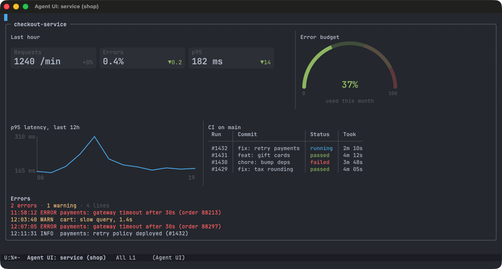

# Project dashboards

A project dashboard is kept in a project's repository, to open again later: after its buffer is closed, after Emacs
restarts. Its data is fetched afresh each time it opens, and none of it is kept, unlike a session's canvas. It suits
what you want to see again for a project (a service's CI and errors, a release's state), while the canvas is for what
the agent shows as it works.



Agent UI's repository has two demos in its own [`.agent-ui/dashboards/`](../.agent-ui/dashboards/), each a full example
of a dashboard that runs a command every second and reads its output: [`cpu`](../.agent-ui/dashboards/cpu.el) (how busy
the machine is, its load, its last minute, its busiest processes) and [`memory`](../.agent-ui/dashboards/memory.el)
(where the memory goes, its pressure, swap, the compressor, the processes holding the most), on macOS and Linux. Open
the repository in Emacs and `M-x agent-ui-open-dashboard`, or copy one into your project's `.agent-ui/dashboards/`.

| Key or command | What it does |
|---|---|
| `M-x agent-ui-open-dashboard` | Open one of the current project's dashboards, in a window of its own. |
| `M-x agent-ui-open-dashboard-here` | The same, in the selected window. |
| `r` (in a dashboard) | Read its file again and run it anew. |
| `E` (in a dashboard) | Save it as a PDF, as it shows now, beside its file. |
| `q` (in a dashboard) | Close it. |
| `S` (on a canvas) | Save the component at point as one of the project's dashboards. |
| `M-x agent-ui-dashboard-forget-project` | Stop trusting one of the projects you trusted. |

- `M-x agent-ui-open-dashboard` lists the current project's dashboards, a row each: its name, its title, how often it's
  fetched, and `open` if it's open, with the project's name and its dashboards' folder under them. One whose file can't
  be read shows its error, dimmed.
- The one you pick opens in a canvas of its own, `Agent UI: NAME (PROJECT)`, in its own window. Its directory is the
  project's root, and it belongs to no session. If it's open already, its window is shown.
- Its title is drawn in its top border, `╭─ TITLE ───╮`, cut with `…` when the window is narrow. A dashboard without a
  border has its title over it.
- `q` closes it and kills its buffer. Opened again later, after a restart too, it's read anew and drawn empty, and its
  code fills it.
- `E` saves the dashboard as it shows now, in your theme's colours, as a one-page PDF beside its file:
  `.agent-ui/dashboards/NAME-DATE-TIME.pdf`. The echo area says where. It needs `rsvg-convert`.

## Its file

Each dashboard is a file, `PROJECT/.agent-ui/dashboards/NAME.el` (the folder is `agent-ui-dashboard-directory`),
committed with the project. It holds one form: what the dashboard shows and the code that fills it, so its components'
ids are written and used in one place.

```elisp
;;; service.el --- Agent UI dashboard: the service -*- lexical-binding: t; -*-
(agent-ui-dashboard
 :version 1
 :ui (:type "panel" :id "service" :title "Service" :layout "row"
      :children ((:type "table" :id "ci" :title "CI" :columns ("Run" "Status"))
                 (:type "gauge" :id "dirty" :title "Unsaved buffers" :value 0 :max 20)))
 :every 30
 :fetch (lambda (dashboard)
          (agent-ui-dashboard-run dashboard '("gh" "run" "list" "-L" "5" "--json" "number,conclusion")
            (lambda (runs)
              (agent-ui-dashboard-update dashboard "ci"
                :rows (mapcar (lambda (r) (list (format "#%s" (alist-get 'number r))
                                                (or (alist-get 'conclusion r) "running")))
                              runs)))
            :component "ci")
          (agent-ui-dashboard-update dashboard "dirty"
            :value (length (seq-filter #'buffer-modified-p (project-buffers (project-current)))))))
```

| Key | What it is |
|---|---|
| `:ui` | What it shows: a component as `show` takes it, written as a plist (`:type "table"`, lists in parentheses, `t` and `:false`), usually a `panel` of children, with its data left out. It's read as data, never evaluated, so it's drawn before its code is trusted. |
| `:every` | The seconds between fetches. Without it, the dashboard is fetched once, when it opens. |
| `:fetch` | A function of the dashboard that fills it. |
| `:start`, `:stop` | Functions of the dashboard, run when it opens and when it closes. |
| `:version` | `1`. |

`agent-ui check NAME` (the MCP tool `check`) checks a file as it's written, and runs nothing. It checks its `:ui` as
`show` would, compiles its code (reporting the compiler's warnings), and finds the calls in it that wait, freezing
Emacs (`shell-command-to-string`, `call-process`, `sleep-for` and the like). Compiling runs its macros
(`eval-when-compile` too), so code you haven't let run isn't compiled; the reply says so.

## Its code

A dashboard's code runs as Emacs itself, and comes from a repository. So before it first runs, you're asked:

| Key | What it does |
|---|---|
| `y` | Run it. |
| `p` | Trust the project: all its dashboards run without asking (once you confirm it with `yes`). |
| `v` | View its file first, read-only, then be asked again. |
| `n` | Not now: it's drawn, nothing runs, and it says so (`r` asks again). |

- Its components' `source`s are commands, so they count as its code too. They don't start before it may run.
- A yes is remembered by the file's content (sha256) and where it is, in `agent-ui-dashboard-trust-file` (under your
  `user-emacs-directory`), not in the repository. The same file isn't asked about again, after a restart too.
- What runs is the file as it was read when the dashboard opened, and that's what a yes is remembered for. If it changes
  while you're asked (your agent editing it), nothing runs and nothing is remembered: `r` reads it again and asks.
- Once the file changes (a pull, an edit), you're asked again. The same file in another repository (a clone, a fork) is
  asked about there, since its scripts aren't the ones you let run.
- A trusted project's dashboards all run without asking, whatever their files become (while your agent builds one, say):
  the project's code is trusted, and so are the scripts they run. `M-x agent-ui-dashboard-forget-project` lists the
  trusted projects and stops trusting one.

Once it may run, `:start` runs, `:fetch` runs at once and every `:every` seconds, and `:stop` runs when it closes.
Each is called with the dashboard, in the project's root (`default-directory`). An error in one of them is kept and said
in `*Messages*`; the others go on.

The code fills the dashboard with:

| Function | What it does |
|---|---|
| `(agent-ui-dashboard-update DASHBOARD ID :PROP VALUE ...)` | Changes a component, as `agent-ui update` does. A value of nil puts a property back to its default. |
| `(agent-ui-dashboard-append DASHBOARD ID :PROP LIST ...)` | Adds to a component's lists, as `agent-ui append` does: a table's rows by key, a chart's values. |
| `(agent-ui-dashboard-get DASHBOARD ID)` | The component's properties now, as a plist. |
| `(agent-ui-dashboard-run DASHBOARD COMMAND CALLBACK :component ID :timeout SECONDS)` | Runs COMMAND (a list, or a string for the shell) in the project's root without waiting, however long it takes. Once it ends well, CALLBACK gets its output, parsed when it reads as JSON (objects as alists, arrays as lists), else as text. It's killed when the dashboard closes, or after `:timeout` seconds. |

Code in a dashboard should never wait: Emacs is frozen meanwhile, at every fetch. Run commands with
`agent-ui-dashboard-run` rather than `shell-command-to-string`, `call-process`, `process-lines` or
`url-retrieve-synchronously`. Emacs's own state (its buffers, `project-current`, `vc`, Flymake's diagnostics) can be
read at once.

## While it's open

- While it's hidden (another buffer in its window, another tab or workspace), it isn't fetched. Shown again, it's
  fetched at once.
- Its queries each load on their own. A query given the `:component` it fills has that component's title say it's
  loading, and for how long (`⟳ loading, 1m 12s`), while its last data stays. On a refresh, that waits until the query
  has taken `agent-ui-dashboard-loading-delay` seconds (0.5), so a quick one doesn't flicker. A failure is said there
  too, until the query goes well.
- A query still running isn't started again. The others go on at their own pace; a slow one never holds them up.
- Anything else that goes wrong is said on the dashboard, in a line in the error face under it, until it goes well. So
  is a fetch that itself takes longer than `agent-ui-dashboard-slow` seconds (0.1), freezing Emacs meanwhile.
- `r` reads its file again (after you edit it) and runs it anew. If the file is wrong, it's said on the dashboard, which
  goes on as it was.
- A project dashboard never closes by itself, as finished components on a canvas do.

## From the agent

- The agent lists the dashboards (`agent-ui dashboards`), opens one for you (`agent-ui open NAME`), and works on an open
  one with `--dashboard NAME` on any operation. With MCP, that's the tools `dashboards` and `open`, and the `dashboard`
  argument.
- `agent-ui open NAME` shows its window without selecting it. If its code must be asked about, you aren't asked
  while you're typing elsewhere: it waits, and says so on the dashboard, until you select it (or press `r` there). The
  reply's `trusted` is false.
- The agent reads what a dashboard shows with `agent-ui get --dashboard NAME`, as data. A dashboard you aren't looking
  at fetches nothing; reading it fetches it first when its data is older than its `:every`, and the command waits for
  its queries (`AGENT_UI_WAIT` seconds at most, 10 by default).
- A dashboard's buttons put their prompt into the project's agent session, the latest one working in it.
- `S` on a canvas saves the component at point as one of the project's dashboards. Its file is written with the
  component as it was first shown, before its updates and its sources' changes, so with no data. Its `:fetch` is empty,
  for you (or the agent) to write. It's trusted, since you made it.
