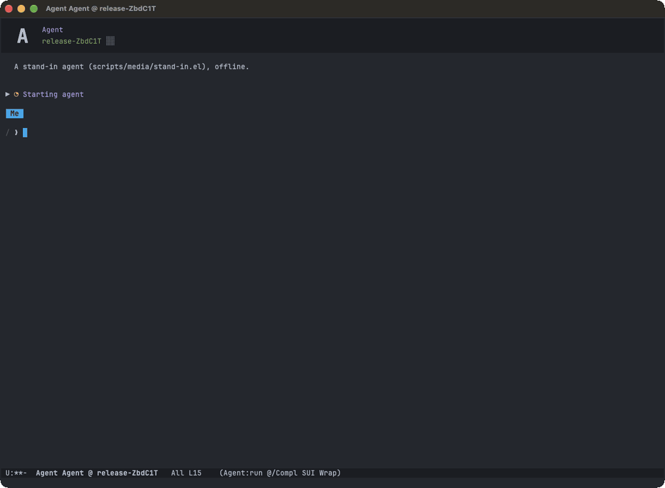

# Getting started

Agent UI works with [agent-shell](https://github.com/xenodium/agent-shell) sessions, whatever agent runs in them. The
agent draws on a **canvas** under its conversation through a small command line, `bin/agent-ui`, or through the same
operations as MCP tools. It works in graphical Emacs and in a terminal.



## The model

- An **component** is data: a JSON object with a `type`, an `id` and the type's properties. The agent doesn't write Lisp
  for the common case, and a component can be saved and shown again.
- An **component type** (`progress`, `table`, and so on) is defined once in Lisp with `agent-ui-define`. It lists its
  properties and has a function that draws it as text, and optionally one that draws it for a graphical frame. The
  types form a registry, and the catalog the agent reads (`agent-ui types`) is made from it.
- A **canvas** is a buffer that belongs to an agent-shell session and is shown at the bottom of the session's pane. It
  holds the session's components in the order they were shown. Showing a component whose id is already there replaces it
  in place, and updating a component redraws only that component.

## Requirements

- Emacs 29.1 or later.
- [agent-shell](https://github.com/xenodium/agent-shell) 0.99.0 or later.
- [vui](https://github.com/d12frosted/vui.el) 1.4.0 or later (used by the `form` component).
- `bash` and `emacsclient`, which `bin/agent-ui` uses to reach Emacs.

Optional tools, each used only by the components that need it:

| Tool | Used for |
|---|---|
| `mmdc` (`npm install -g @mermaid-js/mermaid-cli`) | Drawing `mermaid` diagrams, and Mermaid blocks in `markdown` |
| MathJax for node (`npm install -g mathjax-full`), or `latex` and `dvisvgm` | Typesetting `math` formulas as images |
| `curl` | Downloading an `image` given by URL |
| `rsvg-convert` (librsvg) | Exporting a canvas as a PDF |
| [mermaid-mode](https://github.com/abrochard/mermaid-mode) | Colouring a diagram's source when it isn't drawn |

## Installing

Agent UI is being prepared for MELPA. Once it's there, `M-x package-install RET agent-ui` will install it. Until then,
install it from its repository. Whichever way you use, the package's `bin/`, `assets/` and `skills/` directories must
be installed with its Lisp files: the command line, the MathJax script and the guide the agent reads live there.

With Emacs's built-in `package-vc` (Emacs 29.1 or later):

```elisp
(package-vc-install "https://github.com/smyrgeorge/agent-ui")
```

This installs the dependencies from your package archives. If one of them isn't in your archives, install it first in
the same way from its repository (for example `(package-vc-install "https://github.com/d12frosted/vui.el")`).

With `use-package` and its `:vc` keyword (built in from Emacs 30):

```elisp
(use-package agent-ui
  :vc (:url "https://github.com/smyrgeorge/agent-ui" :rev :newest)
  :config
  (require 'server)
  (unless (server-running-p) (server-start))
  (agent-ui-mode 1))
```

With [straight.el](https://github.com/radian-software/straight.el):

```elisp
(straight-use-package
 '(agent-ui :type git :host github :repo "smyrgeorge/agent-ui"
            :files (:defaults "bin" "assets" "skills")))
```

With Doom Emacs, in `packages.el`:

```elisp
(package! agent-ui
  :recipe (:host github :repo "smyrgeorge/agent-ui"
           :files (:defaults "bin" "assets" "skills")))
```

## Setting it up

```elisp
(require 'agent-ui)
(server-start)        ; bin/agent-ui reaches Emacs through its server
(agent-ui-mode 1)
```

Loading the package changes nothing by itself. `agent-ui-mode` is a global minor mode that installs everything that
touches agent-shell and Emacs, and turning it off removes it again:

- Each agent-shell session starts its agent with `AGENT_UI_SESSION` in its environment, so the command line finds the
  session's own canvas.
- Agents that take a system prompt are told about the canvas in it (`agent-ui-system-prompt`).
- Each session started from then on gets Agent UI's MCP server (`agent-ui-mcp`).
- A question left unanswered when the agent's turn ends is brought to your attention, and the session's mode line
  says so.
- Canvases are saved with their sessions and come back when a session is resumed.
- The canvas's views follow their session's pane as windows change.
- `agent-ui:` links open the canvas they point to, and the types you kept are loaded
  ([Custom types](custom-types.md)).

Emacs must run a server, since the command line talks to it through `emacsclient`. Without one, the command fails with
exit status 3 and a message saying so, and agents aren't told about the canvas at all.

The canvas's keys are plain Emacs keys in `agent-ui-canvas-mode-map` ([The canvas](canvas.md#keys)). If you use Evil,
bind them in its normal state, or let canvases start in Emacs state:

```elisp
(with-eval-after-load 'evil
  (evil-set-initial-state 'agent-ui-canvas-mode 'emacs))
```

You may also want a key to jump to a question waiting for your answer, from any session:

```elisp
(with-eval-after-load 'agent-shell
  (keymap-set agent-shell-mode-map "C-c C-q" #'agent-ui-goto-question))
```

## A first component

Start an agent-shell session and ask the agent to show something, or try the command yourself from a shell inside
Emacs (`M-x shell`, say). The command is `bin/agent-ui` in the package's directory; its full path is in the option
`agent-ui-command`. The examples below call it `agent-ui`.

Show a progress bar:

```sh
agent-ui show '{"id":"build","type":"progress","title":"Build","max":12}'
```

```json
{"ok":true,"id":"build","link":"agent-ui://canvas/default#build"}
```

A canvas opens at the bottom of the pane (or in a window of its own, when the command isn't run from a session), with
the bar on it. Update it, then remove it:

```sh
agent-ui update build '{"value":7,"label":"linking"}'
agent-ui update build '{"value":12,"status":"done","label":"done in 41s"}'
agent-ui remove build
```

```text
Build
███████████████░░░░░░░░░░░  7/12  58%  linking
```

An update is partial: it changes only the properties it gives. A property set to `null` goes back to its default.

A table filling in as tests run, one row per test, each row replaced by its key:

```sh
agent-ui show '{"id":"tests","type":"table","title":"Tests","columns":["Test","Result","Time"],"key":0,"rows":[]}'
agent-ui append tests '{"rows":[["lexer","passed","0.4s"],["parser","running",""]]}'
agent-ui append tests '{"rows":[["parser","failed","1.2s"]]}'
```

```text
Tests
 Test    │ Result │ Time
─────────┼────────┼──────
 lexer   │ passed │ 0.4s
 parser  │ failed │ 1.2s
```

`agent-ui types` lists every type with its properties and an example, and `agent-ui types TYPE` gives one. The
[command line](command-line.md) has every operation, and [Components](components.md) every type.

## What the agent is told

While Emacs runs a server, an agent that takes a system prompt is told about its canvas there. The text is
`(agent-ui-agent-context)`, appended to agent-shell's system prompt when `agent-ui-system-prompt` is non-nil (the
default). Set it to nil to tell agents yourself. Agents that don't take a system prompt still learn of Agent UI
through its MCP server's instructions, when `agent-ui-mcp` is on.

The text has three parts:

- **What to show.** The canvas is where information goes. Whatever has a shape (figures, records, a comparison, a
  trend, a structure, steps, changes, output) goes there as the component that fits it, and the reply keeps the words:
  what was found, what it means, what's next, and a line saying what's on the canvas. What a sentence or two holds
  stays in the reply alone.
  - Kinds of information are matched to components: figures `stats` (one against a target, `gauge`), records `table`, a
    trend or distribution `chart`, two dimensions `heatmap`, a structure or flow `graph` or `mermaid`, durations
    `timeline`, code `code`, changes `diff`, files `files`, output `log`, what one thing is doing now `activity`,
    categories `tags`, formulas `math`, a write-up `markdown`, a picture `image`, a web page `html`, several together
    `panel`.
  - Plans go there without being asked: a plan or the current ticket's acceptance criteria as `steps`, a long build or
    test run as `progress`, `steps` or a table filling in, and a long run of work items as `progress`, updated after
    each one.
  - This comes before any other guidance the agent has on tables, images and diagrams in replies: those are for when
    the canvas can't be used.
- **Asking.** A question goes on a canvas of its own (`--canvas ask`) as the interactive component that fits it: a list
  to pick from is a `choice` (or `select` on a table or files), alternatives to see side by side a `compare`,
  something risky a `confirm`, a plan to agree on `steps` with `approve`, proposed changes a `diff` with `accept`,
  several values a `form`, an order a `rank`, a number a `slider`. Then the agent ends its turn, and your answer is
  its next prompt. When agent-shell's forms for agent questions are on, only a quick question (2 to 4 short options,
  nothing to show or compare) goes in the conversation instead: with AskUserQuestion for Claude Code, or the agent's
  own tool for asking, if it has one.
- **The command.** Its full path with an example, and the path of the skill to read before using it the first time.
  When Agent UI itself misbehaves, the agent is told to ask you and then report it with `agent-ui bug`
  ([Bugs in Agent UI](bugs.md)).

While the text is made, `agent-ui-agent-identifier` holds the agent's identifier as agent-shell's configs name it
(`claude-code`, `codex`, and so on); that's how the text names the right tool for quick questions. Code of your own
that adds to the text (advice on `agent-ui-agent-context`, say) can use it too.

### The skill

The skill, `skills/agent-ui/SKILL.md` in the package (the option `agent-ui-skill`), is the guide the agent reads, in
parts, as it needs them:

- `SKILL.md`, read first, says when to use the canvas (information, plans, questions), how to use the command, every
  type in a line by what it shows, and the everyday ones (`progress`, `steps`, `table`) with examples.
- Its `references/` hold the rest, each read only when a task needs it: asking you (`asking.md`), figures
  (`data.md`), content and layout (`content.md`), following a command (`sources.md`), a type of its own
  (`custom-types.md`), project panels (`panels.md`), and a bug in Agent UI (`bugs.md`).
- A type's every property comes from `agent-ui types TYPE`.

The agent reads it from the package's directory, so there's nothing to install. You can also install it as a skill
for your agent, like any other skill.

## MCP

Each agent-shell session started while `agent-ui-mode` is on (and `agent-ui-mcp` is non-nil, the default) also gets
Agent UI's operations as MCP tools, with their schemas. The server is `agent-ui-mcp.el`, run by a batch Emacs (this
Emacs's own binary) that the agent starts; it's added to `agent-shell-mcp-servers` with the session's name and
directory. Each tool call goes through `bin/agent-ui`, so its replies and errors are the command line's. The tools are
listed in [The command line](command-line.md#mcp-tools).

To turn the tools off:

```elisp
(setq agent-ui-mcp nil)   ; before turning agent-ui-mode on
```

## Next steps

- [The canvas](canvas.md): how the canvas behaves and the keys it has.
- [Components](components.md): what the agent can show and ask.
- [Customization](customization.md): the options.
